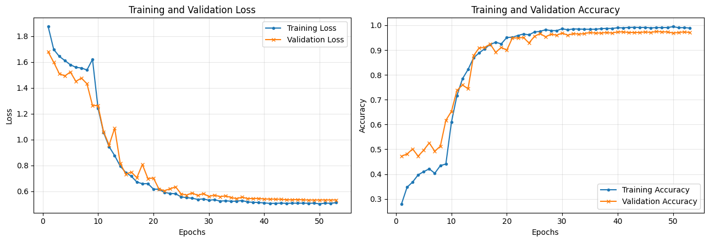
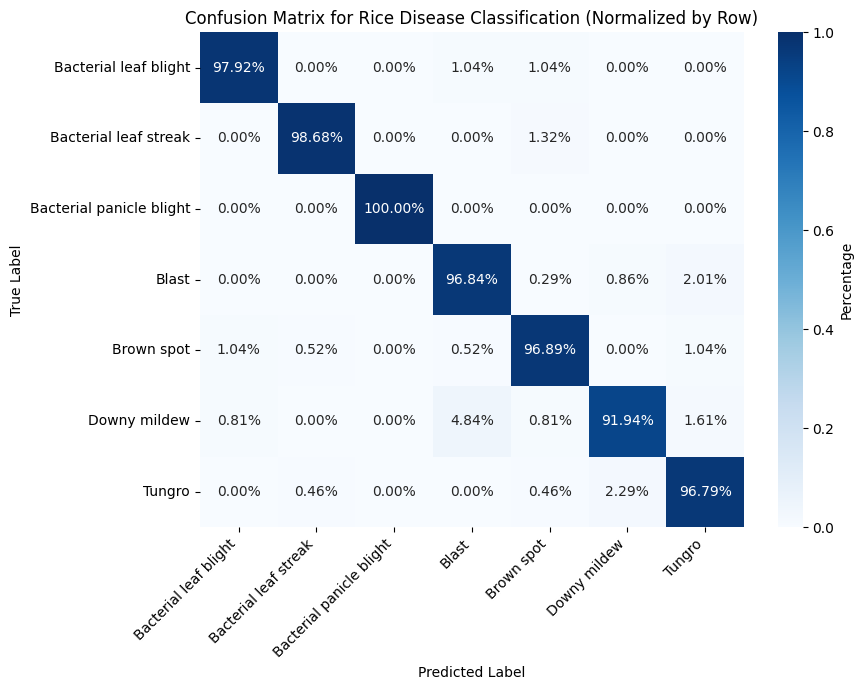

# Rice Leaf Disease Classification Using DenseNet121

**A deep learning-based multi-class rice leaf disease classification project using transfer learning, high-resolution image processing, class imbalance handling, two-phase fine-tuning, and test-time augmentation.**

## Overview

This project implements a deep learning pipeline for classifying seven rice leaf disease categories using **DenseNet121 with ImageNet-pretrained weights**.

The implementation focuses on improving classification performance through higher-resolution image processing, data augmentation, class-weighted training, and a two-phase fine-tuning strategy. It also incorporates mixed-precision computation and Test-Time Augmentation (TTA) to support efficient training and more robust inference.

The final recorded experiment achieved **96.70% accuracy** on a held-out test set of 1,122 images.

## Key Features

- **Transfer Learning:** Uses ImageNet-pretrained DenseNet121 as the feature extraction backbone.
- **Custom Classification Head:** Incorporates Global Average Pooling, dropout layers, a 256-unit fully connected layer, and a seven-class softmax output.
- **High-Resolution Image Processing:** Uses 288 × 384 input images while preserving the original 3:4 aspect ratio.
- **Data Augmentation:** Applies random horizontal and vertical flipping, rotation, zoom, translation, brightness adjustment, and contrast adjustment.
- **Class Imbalance Handling:** Implements softened class weights using the square root of balanced class weights.
- **Two-Phase Fine-Tuning:** Initially trains the classification head with a frozen backbone, followed by full-backbone fine-tuning.
- **Learning Rate Scheduling:** Uses ReduceLROnPlateau and EarlyStopping callbacks.
- **Mixed-Precision Training:** Enables mixed float16 computation when a compatible GPU is available.
- **Test-Time Augmentation:** Averages predictions from original, horizontally flipped, vertically flipped, and doubly flipped images.
- **Reproducibility:** Sets random seeds for Python, NumPy, and TensorFlow.

## Dataset

**Source:** [Kaggle – Paddy Disease Classification](https://www.kaggle.com/competitions/paddy-disease-classification/data)

The original Kaggle dataset contains additional categories. This implementation selects seven disease categories using the `KEEP_CLASSES` configuration.

### Selected Disease Categories

| Disease Category | Number of Images |
|---|---:|
| Blast | 1,738 |
| Tungro | 1,088 |
| Brown Spot | 965 |
| Downy Mildew | 620 |
| Bacterial Leaf Blight | 479 |
| Bacterial Leaf Streak | 380 |
| Bacterial Panicle Blight | 337 |
| **Total** | **5,607** |

### Dataset Splitting

The dataset is divided using stratified sampling with a fixed random seed.

| Subset | Images | Percentage |
|---|---:|---:|
| Training | 4,036 | 72% |
| Validation | 449 | 8% |
| Testing | 1,122 | 20% |
| **Total** | **5,607** | **100%** |

The validation set is separated from the training portion, while the held-out test set is reserved for final evaluation.

## Model Architecture

The proposed classification model is based on DenseNet121 with ImageNet-pretrained weights and a custom classification head.

### Architecture Components

1. DenseNet121 backbone with ImageNet-pretrained weights.
2. Global Average Pooling layer.
3. Dropout layer (0.5).
4. Fully Connected layer (256 neurons, ReLU activation).
5. Dropout layer (0.3).
6. Output layer (7 neurons, Softmax activation).

### Input Configuration

| Parameter | Configuration |
|---|---|
| Input resolution | 288 × 384 |
| Color channels | RGB |
| Batch size | 32 |
| Backbone | DenseNet121 |
| Pretrained weights | ImageNet |
| Output classes | 7 |

## Training Methodology

The model is trained using a two-phase transfer learning strategy.

### Phase 1: Classification Head Training

- Freeze the pretrained DenseNet121 backbone.
- Train only the newly added classification head.
- Use the Adam optimizer with a learning rate of 0.001.
- Train for up to 8 epochs.

### Phase 2: Full-Backbone Fine-Tuning

- Unfreeze the entire DenseNet121 backbone.
- Fine-tune the complete network, including the classification head.
- Use the Adam optimizer with an initial learning rate of 0.0001.
- Train for up to 45 epochs.
- Apply adaptive learning-rate reduction and early stopping based on validation loss.

### Additional Training Strategies

**Class Imbalance Handling**

Balanced class weights are calculated from the training distribution and softened using their square roots before being passed to the training procedure.

**Label Smoothing**

Categorical cross-entropy with a label smoothing factor of 0.1 is used to regularize classification predictions.

**Data Augmentation**

The training pipeline applies six transformations:

- Random horizontal and vertical flipping.
- Random rotation (approximately ±20 degrees).
- Random zoom.
- Random translation.
- Random brightness adjustment.
- Random contrast adjustment.

**Mixed Precision**

Mixed float16 precision is enabled when a compatible GPU is detected. The final classification layer uses float32 output for numerical stability.

**Test-Time Augmentation (TTA)**

During evaluation, four versions of each image are considered:

1. Original image.
2. Horizontally flipped image.
3. Vertically flipped image.
4. Horizontally and vertically flipped image.

The four sets of predicted probabilities are averaged to obtain the final prediction.

## Experimental Results

The final recorded experiment achieved **96.70% overall test accuracy** on the held-out test dataset.

### Overall Evaluation Metrics

The following metrics are calculated from the final test confusion matrix. Sensitivity, specificity, precision, and F-score are macro-averaged across the seven classes.

| Evaluation Metric | Score |
|---|---:|
| Test Accuracy | 96.70% |
| Sensitivity | 97.01% |
| Specificity | 99.42% |
| Precision | 96.84% |
| F1-score | 96.92% |

### Training and Validation Performance

The following plots illustrate the training and validation loss and accuracy throughout the two-phase training process.



### Confusion Matrix

The row-normalized confusion matrix presents the classification performance across the seven rice leaf disease categories.



## Technologies and Libraries

| Category | Technologies |
|---|---|
| Programming Language | Python |
| Deep Learning Framework | TensorFlow / Keras |
| Model Architecture | DenseNet121 |
| Data Processing | NumPy, Pandas |
| Image Processing | TensorFlow Image API |
| Data Visualization | Matplotlib, Seaborn |
| Machine Learning Utilities | Scikit-learn |
| Statistical Analysis | SciPy |
| Dataset Access | Kaggle Competition / Kaggle CLI |

## Repository Structure

```text
rice-leaf-disease-classification/
│
├── README.md
├── requirements.txt
├── rice_leaf_disease_classification.ipynb
│
└── results/
    └── figures/
        ├── training_curves.png
        └── confusion_matrix.png
```

## Installation and Execution

### 1. Clone the Repository

```bash
git clone https://github.com/sn-sakib/rice-leaf-disease-classification.git

cd rice-leaf-disease-classification
```

### 2. Install Dependencies

```bash
pip install -r requirements.txt
```

### 3. Download the Dataset

Access the [Kaggle Paddy Disease Classification competition](https://www.kaggle.com/competitions/paddy-disease-classification/data).

Accept the competition rules and download the dataset.

For automatic download through the Kaggle CLI, configure your Kaggle API credentials.

### 4. Run the Notebook

Open the notebook using Jupyter:

```bash
jupyter notebook rice_leaf_disease_classification.ipynb
```

Configure the dataset path if necessary, then execute the cells sequentially.

A compatible GPU is recommended for efficient model training.

## Experimental Scope and Limitations

- The reported results are from one recorded stratified train-validation-test experiment.
- Five-fold stratified cross-validation is implemented in the notebook but was not executed in the reported experiment.
- The reported performance is based on the selected seven disease categories rather than all ten categories in the original competition dataset.
- Further evaluation on independent datasets is needed to assess generalization beyond the selected dataset.

## Future Improvements

- Execute five-fold stratified cross-validation to evaluate performance stability.
- Evaluate the model on independent rice leaf disease datasets.
- Investigate model explainability using Grad-CAM.
- Compare DenseNet121 with alternative CNN and vision transformer architectures.
- Explore model compression and deployment for practical agricultural applications.

## Author

**Syed Nazmus Sakib**

Machine Learning | Deep Learning | Computer Vision | Artificial Intelligence

[GitHub Profile](https://github.com/sn-sakib)
